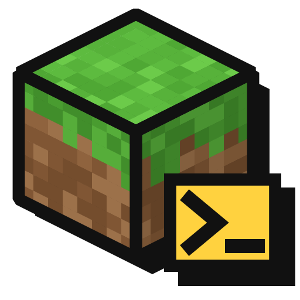
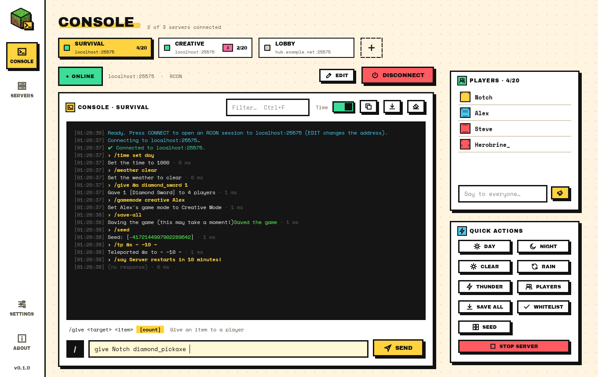
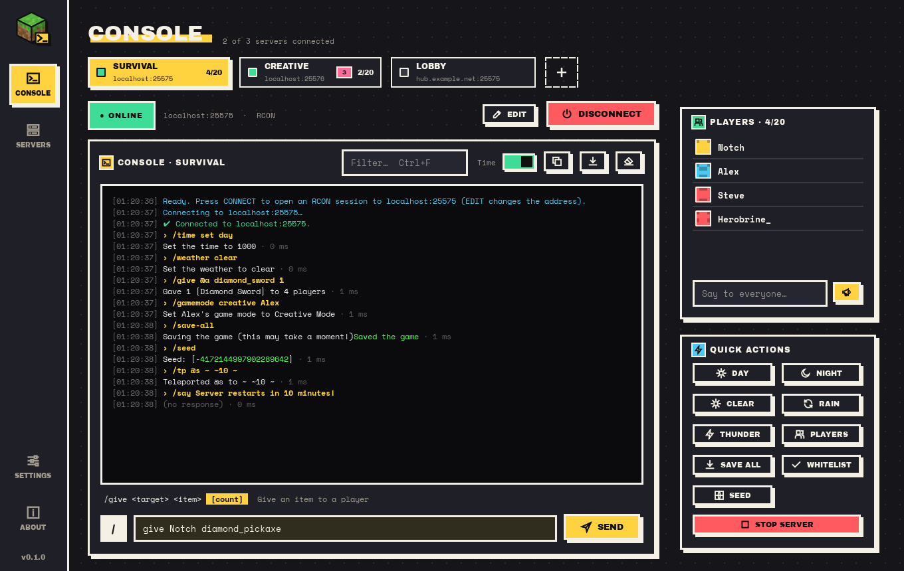
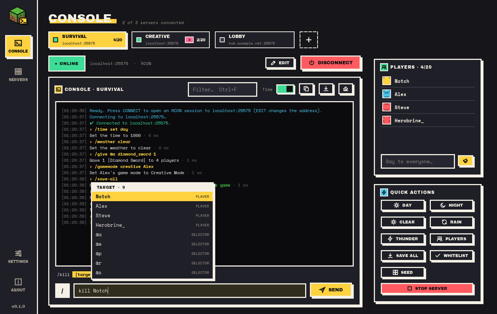
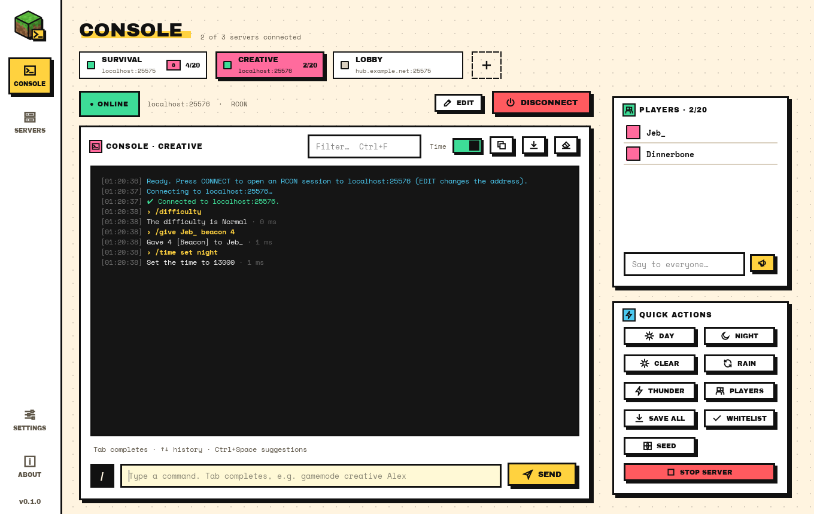
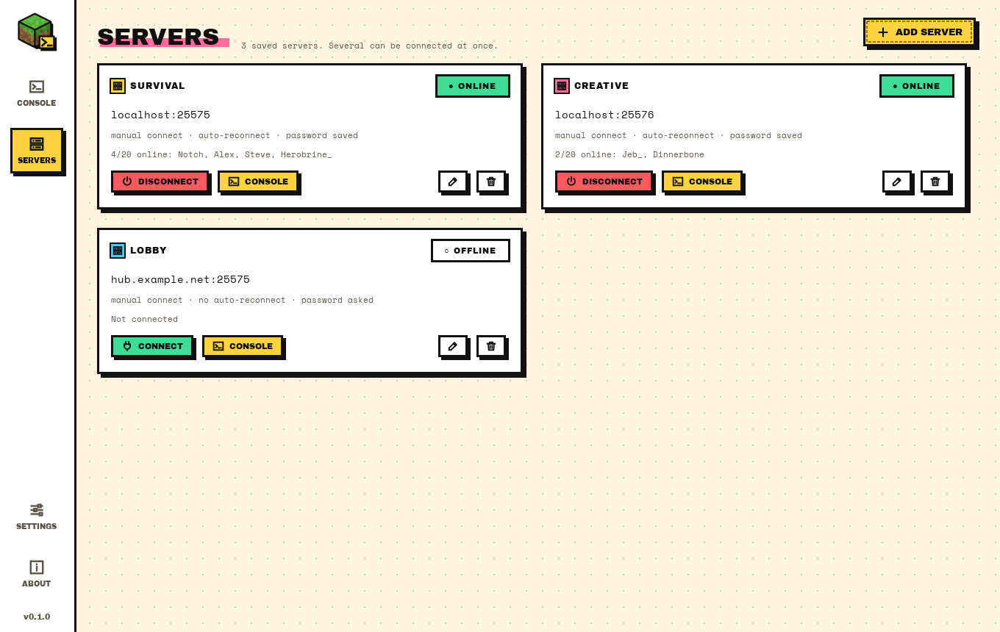
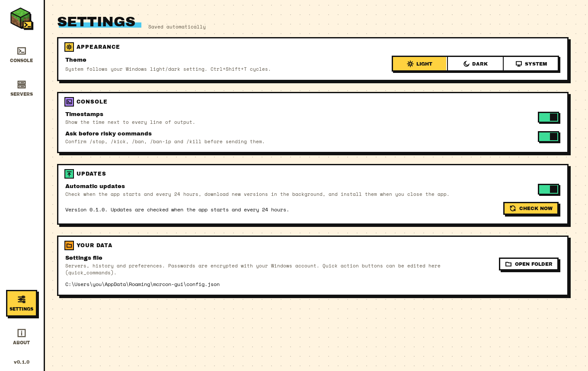
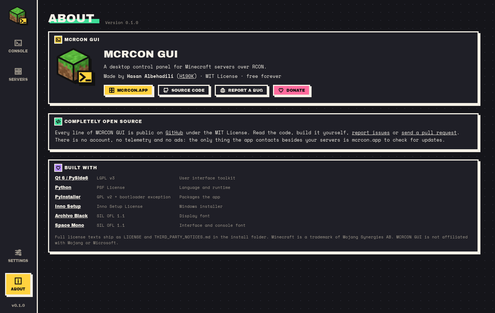

<div align="center">



# MCRCON GUI

**A desktop control panel for Minecraft servers over RCON.**
Run commands with Tab completion, watch players, and manage several servers from one window.

[](https://github.com/H190K/mcrcon_gui/releases)
[](https://github.com/H190K/mcrcon_gui/actions/workflows/ci.yml)
[](LICENSE)
[](https://www.python.org)

[Website](https://mcrcon.app) · [Download](#download) · [Features](#features) · [Setup](#set-up-rcon-on-your-server) · [Shortcuts](#keyboard-shortcuts) · [FAQ](#troubleshooting) · [Contributing](CONTRIBUTING.md)



</div>

## Features

- **Tab completion that knows Minecraft.** Around 60 vanilla commands with their arguments, plus game modes, game rules, items, effects, enchantments and the names of players who are online right now. Type `kill Al`, press <kbd>Tab</kbd>, get `kill Alex`. Type `/game` and pick `gamemode` or `gamerule` from the list.
- **Usage hints while you type.** The line under the console shows the syntax of the command you're writing, e.g. `gamemode <mode> [target]`, with the current argument highlighted.
- **Several servers at once.** Save as many servers as you like and keep more than one connected. Each has its own console, history and status.
- **Players panel.** Live list of who's online (refreshed every 30 seconds and after kicks or bans). Right-click a player to message, teleport, change game mode, op, kick or ban.
- **Readable output.** Minecraft `§` colour codes are rendered, multi-line replies stay aligned, and each reply shows how long the server took.
- **Light and dark themes**, or follow your system setting. The window's title bar matches the theme.
- **Reconnects by itself** when a connection drops, backing off between attempts.
- **Small and dependency-free RCON client.** The protocol is implemented in plain Python. There is no external `mcrcon` binary any more.
- **Passwords protected at rest.** On Windows they are encrypted with your Windows account (DPAPI).
- **Updates itself.** The installed app checks [mcrcon.app](https://mcrcon.app) when it starts and every 24 hours while open, downloads new versions in the background, verifies them, and installs on one click or when you close it. You can also check by hand in **Settings → Updates**.

<table>
  <tr>
    <td width="50%"><p align="center"><sub>Dark theme</sub></p></td>
    <td width="50%"><p align="center"><sub>Tab completion with online players</sub></p></td>
  </tr>
  <tr>
    <td width="50%"><p align="center"><sub>Several servers, one tab each</sub></p></td>
    <td width="50%"><p align="center"><sub>Servers page</sub></p></td>
  </tr>
  <tr>
    <td width="50%"><p align="center"><sub>Settings: theme, console, updates</sub></p></td>
    <td width="50%"><p align="center"><sub>About and open-source credits</sub></p></td>
  </tr>
</table>

The window has four pages, picked from the rail on the left:

- **Console:** server tabs along the top, the selected server's console in the middle, players, broadcast and quick actions on the right.
- **Servers:** every saved server as a card. Connect, edit or remove from here.
- **Settings:** theme, console options, automatic updates and where your data lives.
- **About:** version, links and the open-source projects the app is built on.

## Download

Get the latest version from the [Releases page](https://github.com/H190K/mcrcon_gui/releases).

| System | File | Notes |
|---|---|---|
| Windows 10/11 (64-bit) | `MCRCON-GUI-0.1.0-windows-x64-setup.exe` | Installer. No admin rights needed; adds Start menu and optional desktop shortcuts. |
| Windows 10/11 (64-bit) | `MCRCON-GUI-0.1.0-windows-x64-portable.zip` | Unzip anywhere and run `MCRCON GUI.exe`. |
| macOS / Linux | — | Run from source (below). Native builds are planned. |

> Windows SmartScreen may warn about an unrecognised app because the installer isn't code-signed. Click **More info → Run anyway**. You can check the download against the SHA-256 checksum published with the release.

### Run from source

You need Python 3.10 or newer.

```bash
git clone https://github.com/H190K/mcrcon_gui.git
cd mcrcon_gui
python -m pip install .
mcrcon-gui
```

Or, without installing: `pip install PySide6`, then `python -m mcrcon_gui` from the `src` folder.

## Set up RCON on your server

RCON is off by default. In your server's `server.properties`:

```properties
enable-rcon=true
rcon.port=25575
rcon.password=pick-a-long-random-password
```

Restart the server. In the app, press **Edit** above the console (or **+** in the server tabs to add another), enter the host, port and password, then **Connect**.

> RCON traffic is **not encrypted**. Don't expose the RCON port to the internet; use it on your LAN or through a VPN/SSH tunnel. See [SECURITY.md](SECURITY.md).

## Using the console

Type commands with or without the leading `/`.

| Key | What it does |
|---|---|
| <kbd>Tab</kbd> | Complete the word. If several options fit, fill in what they share; press again to cycle through them. |
| <kbd>Shift</kbd>+<kbd>Tab</kbd> | Cycle backwards |
| <kbd>↑</kbd> <kbd>↓</kbd> | Move through suggestions when the list is open, otherwise through your command history |
| <kbd>Enter</kbd> | Accept the highlighted suggestion, or send the command |
| <kbd>Esc</kbd> | Close the suggestions; press again to clear the line |
| <kbd>Ctrl</kbd>+<kbd>Space</kbd> | Show suggestions |

Completion works inside nested commands too: `execute as @a run give ` continues with the arguments of `give`. Commands added by plugins (Paper, Spigot, Fabric mods) are picked up from the server's `help` output and offered by name.

Commands that can hurt (`stop`, `kick`, `ban`, `ban-ip`, `kill`) ask for confirmation first.

## Keyboard shortcuts

| Shortcut | Action |
|---|---|
| <kbd>Ctrl</kbd>+<kbd>Enter</kbd> | Connect / disconnect the current server |
| <kbd>Ctrl</kbd>+<kbd>K</kbd> | Jump to the command line |
| <kbd>Ctrl</kbd>+<kbd>F</kbd> | Filter the console |
| <kbd>Ctrl</kbd>+<kbd>L</kbd> | Clear the console |
| <kbd>Ctrl</kbd>+<kbd>E</kbd> | Export the console to a file |
| <kbd>Ctrl</kbd>+<kbd>N</kbd> | Add a server |
| <kbd>Ctrl</kbd>+<kbd>1</kbd> … <kbd>9</kbd> | Switch to server 1–9 |
| <kbd>Ctrl</kbd>+<kbd>Tab</kbd> | Next server |
| <kbd>Ctrl</kbd>+<kbd>Shift</kbd>+<kbd>T</kbd> | Switch theme: light → dark → system |
| <kbd>Ctrl</kbd>+<kbd>,</kbd> | Settings |
| <kbd>F1</kbd> | About and credits |

Double-click a server tab to connect or disconnect it. Double-click a player to insert their name into the command line.

## Updates

The installed Windows app looks for a new version every time it starts, and again every 24 hours if you leave it open. When one is out:

1. It downloads the installer in the background and checks its SHA-256 against the published manifest.
2. An **Install** button appears next to the Console title, and Settings shows a badge. Click it to update now (the app restarts itself), or just keep working: the update is applied silently the next time you close the app.

**Settings → Updates → Check now** checks immediately. Switch off *Automatic updates* on the same page to stop the automatic checks. The portable zip and source installs only show a notice with a link to the download page.

## Settings and data

Settings are saved in one JSON file, shown in the app's footer:

| System | Location |
|---|---|
| Windows | `%APPDATA%\mcrcon-gui\config.json` |
| macOS | `~/Library/Application Support/mcrcon-gui/config.json` |
| Linux | `~/.config/mcrcon-gui/config.json` |

- Writes are atomic, and the previous version is kept as `config.json.bak`. If the file ever gets corrupted, the app falls back to the backup.
- **Passwords:** encrypted with Windows DPAPI on Windows (readable only by your Windows account). On macOS and Linux they're stored as plain text in a file only your user can read. Untick *Remember password* if that isn't good enough. You'll then be asked for it on each connect.
- Command history is kept per server (last 200 commands).
- Quick action buttons can be changed by editing `quick_commands` in the file.
- Settings from the old 2025 versions (`config.json` next to the program) are imported automatically on first start.

## Troubleshooting

**"Could not reach host:port (connection refused)"**
RCON isn't enabled, the port is wrong, or the server isn't running. Check `enable-rcon` and `rcon.port` in `server.properties` and restart the server.

**"Wrong RCON password"**
Copy `rcon.password` from `server.properties` exactly; it's case-sensitive.

**It connects at home but not remotely**
The RCON port must be reachable: open it in your firewall/hosting panel, or better, use a VPN or SSH tunnel.

**Does it work with Bedrock Edition?**
No. Bedrock servers don't support RCON.

**Does it work with Paper, Spigot, Purpur, Fabric, Forge?**
Yes. They all use the same RCON protocol. Plugin commands appear in the completion list after you connect.

**The app won't start**
Look for `crash.log` in the settings folder above and attach it to a [bug report](https://github.com/H190K/mcrcon_gui/issues/new/choose).

## Building

```bash
python -m pip install -e ".[dev]"
python -m pytest            # 60+ tests, including headless UI tests
python tools/build.py       # app folder + portable zip (+ installer on Windows with Inno Setup 6)
```

There's a fake RCON server for trying things without Minecraft:

```bash
python tools/fake_server.py --port 25575 --password test
```

Everything else about the code (layout, how completion works, adding commands) is in [CONTRIBUTING.md](CONTRIBUTING.md).

## Support the project

- Star the repo and share it with other server admins
- Report bugs or ideas in [Issues](https://github.com/H190K/mcrcon_gui/issues)
- Send a pull request, see [CONTRIBUTING.md](CONTRIBUTING.md)

If the app saves you time, you can also support development:

<div align="center">

[](https://donation.h190k.com/)
[](https://nowpayments.io/donation?api_key=J0QACAH-BTH4F4F-QDXM4ZS-RCA58BH)

</div>

## Author

Made by **Hasan Albehadili** ([H190K](https://github.com/H190K)).
Twitter/X: [@h190k](https://twitter.com/h190k) · Email: [info@h190k.com](mailto:info@h190k.com)

## License

MCRCON GUI is free software under the [MIT License](LICENSE). Bundled third-party components (Qt/PySide6, fonts) are listed in [THIRD_PARTY_NOTICES.md](THIRD_PARTY_NOTICES.md).

Minecraft is a trademark of Mojang Synergies AB. This project is not affiliated with Mojang or Microsoft.
